<p align="center">
  
</p>

<h1 align="center">AppBridge</h1>

<p align="center">
  <a href="https://github.com/Kolgrim33/appbridge/actions/workflows/ci.yml"></a>
  <a href="https://github.com/Kolgrim33/appbridge/releases/latest"></a>
  <a href="#license"></a>
</p>

<p align="center">
  
</p>

## Quick Install

```bash
# Install directly via Cargo (Linux, Windows, macOS)
cargo install --git https://github.com/Kolgrim33/appbridge appbridge-cli

# Or download prebuilt binaries (Linux x86_64, macOS ARM64, Windows x86_64)
# from https://github.com/Kolgrim33/appbridge/releases/latest
```

## A Rust-Powered Universal Application Portability Engine

**One application ecosystem. Three operating systems. One bridge.**

AppBridge is an open-source, library-first Rust platform for running, converting, and managing software across **Linux**, **Windows**, and **macOS**.

Rather than conflating compatibility-layer execution with package conversion, AppBridge separates its core into two independent engines built on shared binary inspection, dependency resolution, lifecycle management, and security primitives:

1. **RUN ENGINE (`create_run_plan` / `appbridge run`)**:
   - Executes foreign or native applications on the current host by selecting the highest-ranked compatible backend (`native`, `wine`, `distrobox`, `wsl`, `vm`, or `darling`) and staging companion libraries (such as third-party Windows `.dll` imports or DXVK/VKD3D-Proton layers).
   - Managed by the **Execution Lifecycle Manager (`ExecutionLifecycleManager`)** with PID tracking, timeout enforcement, cooperative cancellation (`CancellationToken`), per-run stdout/stderr log capture, structured crash diagnostics (`crash-report.json`), and transactional installation rollback (`RollbackGuard`).
2. **CONVERSION ENGINE (`create_conversion_plan` / `appbridge convert` / `appbridge build`)**:
   - **Mode A — Production-Grade Native Package Repackaging**: Evaluates an explicit `ConversionClassification` (`SAFE_TO_CONVERT`, `CONVERT_WITH_WARNINGS`, `UNSUPPORTED`), normalizes Debian version constraints and virtual/OR-clause dependencies, checks ELF `DT_NEEDED` shared library `SONAME` compatibility, distinguishes declarative maintainer triggers (`ldconfig`, `update-desktop-database`) from unsafe scripts, preserves `.desktop`/icon/MIME entries, normalizes `0o755`/`0o644` root permissions, checks pre-install file conflicts, and builds installable Arch Linux `.pkg.tar.zst` packages.
   - **Mode B — `.appbridge` Portable Format (`v1.1`)**: Produces bit-for-bit reproducible, self-verifying `.appbridge` bundles containing `manifest.toml` (with `RuntimeSpecification`), `recipe/appbridge.toml`, CycloneDX 1.5 SBOM (`metadata/sbom.cdx.json`), SLSA build provenance (`metadata/provenance.json`), SHA-256 file checksums (`metadata/checksums.json`), optional publisher signatures (`metadata/signature.json`), and delta update calculations (`BundleManager::compute_delta`).
   - **Mode C — Source-to-Platform Building**: Compiles source trees (`Cargo.toml`, `CMakeLists.txt`, `meson.build`, `Makefile`, `go.mod`) into native binaries with SHA-256 build receipts.

---

## Using AppBridge as a Rust Library (`bridge-core` SDK)

AppBridge is designed first and foremost as a **Rust library** that package managers, game launchers, developer tools, and enterprise deployment systems can embed directly.

### 1. Add `bridge-core` to `Cargo.toml`

```toml
[dependencies]
bridge-core = { git = "https://github.com/Kolgrim33/appbridge", branch = "main" }
```

### 2. High-Level SDK Usage

```rust
use bridge_core::{
    AppBridgeEngine, BackendId, BundleManager, BundleSigningKey, ConversionClassification,
    ConversionTarget, CpuArch, HostProfile, LinuxDistro, OsFamily,
};
use std::path::Path;

fn main() -> Result<(), Box<dyn std::error::Error>> {
    // 1. Initialize the engine (auto-detect host or target a synthetic profile)
    let host = HostProfile::synthetic(OsFamily::Linux, Some(LinuxDistro::Arch), CpuArch::X86_64);
    let engine = AppBridgeEngine::with_host_and_data_root(host, "/tmp/appbridge-state")?;

    // 2. Plan execution or conversion directly from a path
    let run_plan = engine.create_run_plan_for("./fixtures/winemine.exe")?;
    let conv_plan = engine.create_conversion_plan_for(
        "./fixtures/sample-ubuntu-app.deb",
        ConversionTarget::Arch,
    )?;
    assert_eq!(conv_plan.classification, ConversionClassification::SafeToConvert);

    // 3. Repackage Debian .deb -> installable Arch Linux .pkg.tar.zst
    let (_, receipt) = engine.convert(
        Path::new("./fixtures/sample-ubuntu-app.deb"),
        ConversionTarget::Arch,
        None,
        None,
        Path::new("/tmp/sample-ubuntu-app.pkg.tar.zst"),
    )?;
    println!("Converted Arch package SHA-256: {}", receipt.output_sha256);

    // 4. Create a reproducible, cryptographically signed .appbridge v1.1 bundle with SBOM & provenance
    let desc = engine.inspect(Path::new("./fixtures/sample-ubuntu-app.deb"))?;
    let signing_key = BundleSigningKey::from_secret("publisher-demo-key", "acme-secret-seed");
    BundleManager::create_signed_bundle(
        &desc,
        OsFamily::Linux,
        run_plan.recommended_backend.unwrap_or(BackendId::Native),
        &signing_key,
        Path::new("/tmp/sample.appbridge"),
    )?;
    let report = BundleManager::verify_bundle_with_key("/tmp/sample.appbridge", Some(&signing_key))?;
    assert!(report.integrity_ok && report.signature_valid == Some(true));
    Ok(())
}
```

Run the self-contained SDK example directly from the workspace:

```bash
cargo run -p bridge-core --example embed_sdk
```

---

## Reproducible Installation & Verification Instructions

### Prerequisites

- **Rust Toolchain**: `rustup` (`stable` or `nightly`, Rust 2024 edition)
- **Linux System Tools (for full E2E conversion & Wine tests)**:
  - **Arch Linux**: `sudo pacman -S --needed base-devel gcc clang lld zstd fakeroot wine`
  - **Ubuntu / Debian**: `sudo apt-get install -y build-essential gcc clang lld zstd fakeroot`

### Build & Install the CLI

```bash
git clone https://github.com/Kolgrim33/appbridge.git
cd appbridge
cargo build --release --bin appbridge
./target/release/appbridge --version
```

### Verify All 6 Engineering & Hardening Test Suites

AppBridge includes an end-to-end engineering validation suite in [`crates/bridge-core/tests/dual_engine_integration.rs`](crates/bridge-core/tests/dual_engine_integration.rs):

| Suite | What the Test Proves | Command to Reproduce |
|---|---|---|
| **1. Arch Conversion (`pacman -U`)** | Compiles a C ELF64 binary with `gcc`, packages it into a Debian `.deb` (with `.desktop` + `.svg` icon), converts it to `.pkg.tar.zst`, validates with `pacman -Qip`/`-Qlp`, installs into a clean root with `fakeroot pacman -U --noconfirm`, verifies `pacman -Qi`, and runs the installed binary. | `cargo test -p bridge-core --test dual_engine_integration test_1_package_conversion_arch_pacman_and_execution -- --nocapture` |
| **2. Windows GUI + Companion DLL Execution** | Compiles a real third-party PE64 Windows GUI executable (`PhotoStudioPro.exe`, `SUBSYSTEM:WINDOWS`) and a custom companion PE64 DLL (`pixelengine.dll`), verifies `goblin` PE import analysis, stages both into an isolated `WINEPREFIX`, creates a live 640x480 Win32 window via `user32.dll`/`gdi32.dll`, and executes under Wine. | `cargo test -p bridge-core --test dual_engine_integration test_2_real_third_party_windows_gui_application_with_dll_execution_via_wine -- --nocapture` |
| **3. Cross-Machine `.appbridge` Bundle Portability** | Produces a signed/checksummed `.appbridge` bundle on Machine A, deletes Machine A's workspace, and verifies (`verify-bundle`), installs, and runs the payload in a separate isolated `APPBRIDGE_HOME` on Machine B (and across separate VMs in GitHub Actions). | `cargo test -p bridge-core --test dual_engine_integration test_3_cross_machine_appbridge_bundle_portability -- --nocapture` |
| **4. Security Review (Extraction & Process Execution)** | Blocks raw tar path traversal (`..`), two-stage symlink escapes, FIFO/device node injection, single-byte payload tampering, unlisted archive member injection, setuid/setgid bits, `LD_PRELOAD` hijacking, shell metacharacter injection, null-byte arguments, and untrusted `postinst` maintainer scripts. | `cargo test -p bridge-core --test dual_engine_integration test_4_independent_security_review_extraction_and_process_execution -- --nocapture` |
| **5. Live Source-to-Platform Build** | Invokes `cargo build --release` on a source project via `appbridge build`, records the output binary SHA-256, and executes the resulting native binary. | `cargo test -p bridge-core --test dual_engine_integration test_5_live_source_to_platform_build_and_execution -- --nocapture` |
| **6. Hardening Suite (Priorities 1–6)** | Verifies `SAFE_TO_CONVERT` / `CONVERT_WITH_WARNINGS` / `UNSUPPORTED` classifications, bit-for-bit reproducible signed `.appbridge` bundles, CycloneDX SBOM & SLSA provenance, delta updates (`compute_delta`), `ExecutionLifecycleManager` timeouts & `CrashReport` generation, `RollbackGuard`, and `CompatibilityTrustLevel`. | `cargo test -p bridge-core --test dual_engine_integration test_6_hardening_priorities_classifications_signed_bundles_lifecycle_and_registry -- --nocapture` |

Run the entire workspace test suite at once:

```bash
cargo test --workspace -- --nocapture
```

---

## Documentation & Specifications

- **[`.appbridge` Portable Bundle Specification (v1.1)](docs/APPBRIDGE_BUNDLE_SPEC.md)** — Archive layout, reproducible tar/gzip parameters, CycloneDX SBOM, SLSA provenance, publisher signing, and delta updates.
- **[Security Audit Matrix (`SECURITY.md`)](SECURITY.md)** — Threat model and automated test coverage for archive extraction and process execution.
- **[Engineering Roadmap (`ROADMAP.md`)](ROADMAP.md)** — Milestones from `0.1.0` through `1.0.0`.

---

## License

Dual-licensed under `MIT OR Apache-2.0`.
