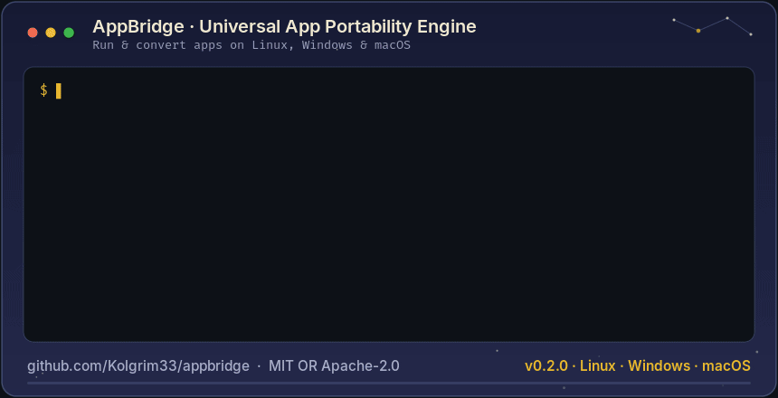

<p align="center">
  
</p>

<h1 align="center">AppBridge</h1>

<p align="center"><b>Run and convert apps across Linux, Windows and macOS.</b><br/>An open-source engine and CLI written in Rust.</p>

<p align="center">
  <a href="https://github.com/Kolgrim33/appbridge/actions/workflows/ci.yml"></a>
  <a href="https://github.com/Kolgrim33/appbridge/releases/latest"></a>
  <a href="#license"></a>
</p>

<p align="center">
  
</p>

## The problem

You have a Windows `.exe`, or a `.deb` built for Ubuntu, and you are on Arch. Today you pick between Wine, containers and conversion scripts by hand, and you find out whether it worked after installing it.

AppBridge looks at the file first and tells you what will work, then does it:

| You have | You are on | AppBridge can |
|---|---|---|
| Windows `.exe` | Linux | Plan and run it through Wine, checking for kernel-level anti-cheat first |
| Ubuntu `.deb` | Arch Linux | Convert it into a `.pkg.tar.zst` you install with `pacman -U` |
| Any app | Any OS | Pack it into one verifiable `.appbridge` bundle |
| Rust/C/C++/Go source | Any OS | Build it and record a SHA-256 receipt |

It never promises more than it can do. Every conversion is labelled `SAFE_TO_CONVERT`, `CONVERT_WITH_WARNINGS` or `UNSUPPORTED` before anything is written.

## How AppBridge compares

| Tool | Pre-flight binary & script inspection | `.deb` → Arch `.pkg.tar.zst` | Windows `.exe` runner | Reproducible bundles + SBOM | Embeddable Rust SDK |
|---|---|---|---|---|---|
| **AppBridge** | Static ELF/PE/Mach-O + `SONAME` + anti-cheat checks | Yes (`SAFE_TO_CONVERT` / warnings / blocked) | Yes (Wine + isolation + crash reports) | Yes (`.appbridge`, CycloneDX 1.5, SHA-256) | Yes (`bridge-core`) |
| **debtap** | No pre-flight safety classification | Yes | No | No | No |
| **alien** | Minimal (often breaks on Arch / scripts) | No (`.rpm`/`.deb`/`.tgz`) | No | No | No |
| **Bottles / Lutris** | Community scripts | No | Yes | No | No |
| **Distrobox** | Runs full container OS | No native package conversion | No | No | No |

## Install

```bash
cargo install --git https://github.com/Kolgrim33/appbridge appbridge-cli
```

Or download a binary for Linux, Windows or macOS from the [latest release](https://github.com/Kolgrim33/appbridge/releases/latest).

## Try it

The repo ships fixtures, so you can run these straight away after cloning:

```bash
# See what would happen to a Windows game on your machine
appbridge plan recipes/windows-dx12-game.appbridge.toml

# Convert an Ubuntu .deb into an Arch package
appbridge convert fixtures/sample-ubuntu-app.deb --to arch --output studio-code.pkg.tar.zst
sudo pacman -U studio-code.pkg.tar.zst

# Wrap a Windows app into a portable bundle and verify it
appbridge convert fixtures/winemine.exe --to appbridge --target linux --backend wine --output winemine.appbridge
appbridge verify-bundle winemine.appbridge

# Run a Windows executable (needs Wine installed)
appbridge run fixtures/windows-hostname.exe
```

## How it works

AppBridge has two separate engines on top of one inspector, so running a file is never confused with converting it.

- **Run engine** (`appbridge run`): reads PE, ELF and Mach-O files without executing them, ranks the available backends (native, Wine, Distrobox, WSL2, QEMU, Darling), and runs the app in an isolated environment. It tracks the process, enforces timeouts and writes a crash report on failure.
- **Conversion engine** (`appbridge convert`, `appbridge build`): repackages `.deb` into Arch packages after mapping dependencies and checking shared libraries and install scripts, builds `.appbridge` bundles, and builds from source.

An `.appbridge` bundle is a reproducible archive with a recipe, SHA-256 checksums, an SBOM (CycloneDX 1.5), build provenance, and an optional publisher signature. See the [bundle spec](docs/APPBRIDGE_BUNDLE_SPEC.md).

## Use it as a Rust library

The CLI is a thin layer over `bridge-core`, so you can embed the same engine:

```rust
use bridge_core::{AppBridgeEngine, ConversionTarget, CpuArch, HostProfile, LinuxDistro, OsFamily};
use std::path::Path;

fn main() -> Result<(), Box<dyn std::error::Error>> {
    let host = HostProfile::synthetic(OsFamily::Linux, Some(LinuxDistro::Arch), CpuArch::X86_64);
    let engine = AppBridgeEngine::with_host_and_data_root(host, "/tmp/appbridge-state")?;

    let deb = Path::new("fixtures/sample-ubuntu-app.deb");
    let (_, run_plan) = engine.create_run_plan(deb)?;
    let (_, conv_plan) = engine.create_conversion_plan(deb, ConversionTarget::Arch)?;
    println!("run with {:?}, safe to convert: {}", run_plan.recommended_backend, conv_plan.is_safe_to_convert);

    engine.convert(deb, ConversionTarget::Arch, None, None, Path::new("/tmp/out.pkg.tar.zst"))?;
    Ok(())
}
```

A full runnable version lives in [`crates/bridge-core/examples/embed_sdk.rs`](crates/bridge-core/examples/embed_sdk.rs): `cargo run -p bridge-core --example embed_sdk`.

## Status

AppBridge is early (`0.2`). The Debian to Arch conversion is tested against real `pacman -U` in CI, and the Windows path is tested against real Wine on Linux. Conversion is limited to compatible packages, and Windows apps run through Wine, so anything Wine cannot run, AppBridge cannot run either. The CI also builds and tests on Windows and macOS.

Progress and plans: [ROADMAP.md](ROADMAP.md). Security model: [SECURITY.md](SECURITY.md).

## Contributing

Contributions are welcome. Look for issues labelled [`good first issue`](https://github.com/Kolgrim33/appbridge/labels/good%20first%20issue) and read [CONTRIBUTING.md](CONTRIBUTING.md). Run `cargo fmt`, `cargo clippy` and `cargo test --workspace` before opening a PR.

## Author

Created by [Selby Mashiki](https://github.com/Kolgrim33).

## License

Dual-licensed under [MIT](LICENSE-MIT) OR [Apache-2.0](LICENSE-APACHE).
